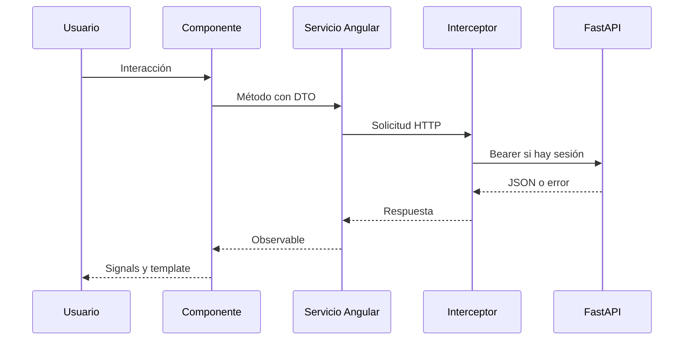

# Directorios y flujos

[Índice](README.md)

| Ruta bajo `src/app/` | Responsabilidad |
| --- | --- |
| `app.config.ts`, `app.routes.ts` | Proveedores y lazy routing |
| `core/config/` | Endpoints del backend |
| `core/models/` | Contratos TypeScript |
| `core/services/` | HTTP por dominio, sesión, tema e idioma |
| `core/guards/`, `core/interceptors/` | Navegación protegida y Bearer |
| `core/i18n/`, `core/utils/` | Diccionarios y errores |
| `features/auth/` | Login/registro/perfil |
| `features/experience/` | Catálogo, detalle, publicación |
| `features/booking/` | Checkout, entradas, devolución e ingresos; SaaS condicionado |
| `features/matching/` | Grupos, disponibilidad y demanda con recomendaciones |
| `features/notifications/` | Bandeja propia y recuperación periódica de avisos |
| `features/live/` | Contratos de sprints posteriores |
| `shared/` | Componentes y pipes reutilizables |
| `shared/ui/` | Botones, controles de formulario, mensajes, encabezados, estados y diálogo |
| `scripts/check-translations.mjs` | Paridad de idiomas y auditoría de claves estáticas |

Para una historia nueva: acordar primero contrato de API y estados, añadir modelo/método HTTP, implementar la vista y sus rutas, aplicar permisos y traducciones, probar contrato y recorrido. Compartir la lógica de transporte en servicios; mantener importes finales y disponibilidad bajo autoridad del backend.
